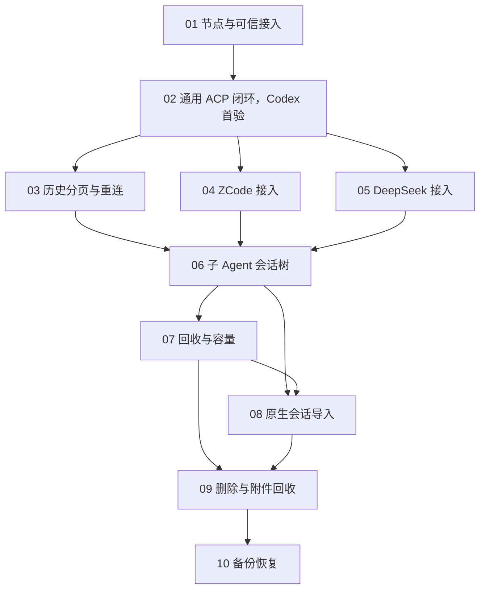

# 重建能力地图与 change 依赖

更新：2026-10-30。节点接入已实现、独立验收通过并归档，其余change仍按各自计划推进；实施和检视结论见对应plan/review。

接入范围修订：用户因当前未安装 Claude，明确以 ZCode 替换。ZCode 接入路径和能力待核实，原 Claude 调研结论不适用；仍拆为10个 change，依赖随详细设计补齐，见下图。

## 本轮 ACP 边界修订

产品规则以重设计§4.5为准；版本策略和模块划分见通用闭环design。02负责共用客户端、v1/v2策略及业务合同，04/05只负责启动/认证引用配置、真实能力和兼容证据，标准路径禁止厂商分支，不建立专属生命周期或页面流。不兼容时报告用户决策，不自动增加私有桥接。升级进行影响复验而非每次改代码，旧版本证据保留但不直接证明新版本。

本轮新增用例/任务待实施；原独立review仅适用于其记录的旧快照，本轮修订须重新检视，产品多版本与真实Harness验收未执行。其他七项只复用02合同，不另行建立ACP协议实现。

## 依据与使用方式

产品行为的权威来源是 [Harness Control Plane 重设计](HARNESS_CONTROL_PLANE_REDESIGN.md)，本文只维护能力归属、依赖和交付边界，不取代其中规则。用户已授权“先建立整体能力地图及依赖关系，再按可独立验收的闭环拆成多个 change”。当前已有节点接入实现及其长期规格，后续能力不能据此视为已交付；不引入旧系统兼容要求。

用户后续授权将全部10个 change 补齐到待实现文档状态：proposal、specs、design、独立tests、plan和tasks。独立检视与产品实际验收分别记录；提案中的验收出口是需要达到的目标，不是已经通过的证据。OpenSpec 不自动执行本文的跨 change 依赖，开工前必须复核上游实际交付、能力探测和检视结果。

## 变更文档索引

10个change均已具备proposal、specs、design、tests、plan、tasks六类产物。下表按当前文件统计：共 193 条用例（L1–L6 共 192 条、LX 共 1 条），任务列仅统计未完成checkbox。前两项已调整，本轮按索引03–10顺序完成其余8项的测试流程修订，保留118条用例编号、标题及行为断言，独立安全检视归L5；首项现为33例，取代此前34例计数。历史修订与检视快照的旧计数保留在原报告，不作为当前总数。各项严格结构校验与本轮自检只证明文档结构及关联，不代表独立检视或产品验收通过；本轮新文本待独立复核，历史版本、问题与结论见[总体独立检视](REBUILD_PLANNING_REVIEW.md)及各review.md。

| Change | 规划状态 | 用例数 | 未完成任务 | 实施计划 | 独立检视 |
|---|---|---|---|---|---|
| [establish-node-access](../openspec/changes/archive/2026-10-30-establish-node-access/proposal.md) | 已归档（15/15完成） | 33 | 0 | [plan](../openspec/changes/archive/2026-10-30-establish-node-access/plan.md) | [review](../openspec/changes/archive/2026-10-30-establish-node-access/review.md) |
| [deliver-codex-session-loop](../openspec/changes/deliver-codex-session-loop/proposal.md) | 6/6产物齐备 | 42 | 14 | [plan](../openspec/changes/deliver-codex-session-loop/plan.md) | [review](../openspec/changes/deliver-codex-session-loop/review.md) |
| [deliver-history-navigation](../openspec/changes/deliver-history-navigation/proposal.md) | 6/6产物齐备 | 25 | 9 | [plan](../openspec/changes/deliver-history-navigation/plan.md) | [review](../openspec/changes/deliver-history-navigation/review.md) |
| [integrate-zcode-harness](../openspec/changes/integrate-zcode-harness/proposal.md) | 6/6产物齐备 | 14 | 13 | [plan](../openspec/changes/integrate-zcode-harness/plan.md) | [review](../openspec/changes/integrate-zcode-harness/review.md) |
| [integrate-deepseek-harness](../openspec/changes/integrate-deepseek-harness/proposal.md) | 6/6产物齐备 | 15 | 13 | [plan](../openspec/changes/integrate-deepseek-harness/plan.md) | [review](../openspec/changes/integrate-deepseek-harness/review.md) |
| [deliver-agent-session-tree](../openspec/changes/deliver-agent-session-tree/proposal.md) | 6/6产物齐备 | 15 | 12 | [plan](../openspec/changes/deliver-agent-session-tree/plan.md) | [review](../openspec/changes/deliver-agent-session-tree/review.md) |
| [deliver-session-capacity](../openspec/changes/deliver-session-capacity/proposal.md) | 6/6产物齐备 | 18 | 12 | [plan](../openspec/changes/deliver-session-capacity/plan.md) | [review](../openspec/changes/deliver-session-capacity/review.md) |
| [deliver-native-session-import](../openspec/changes/deliver-native-session-import/proposal.md) | 6/6产物齐备 | 10 | 12 | [plan](../openspec/changes/deliver-native-session-import/plan.md) | [review](../openspec/changes/deliver-native-session-import/review.md) |
| [deliver-session-data-lifecycle](../openspec/changes/deliver-session-data-lifecycle/proposal.md) | 6/6产物齐备 | 11 | 12 | [plan](../openspec/changes/deliver-session-data-lifecycle/plan.md) | [review](../openspec/changes/deliver-session-data-lifecycle/review.md) |
| [deliver-backup-recovery](../openspec/changes/deliver-backup-recovery/proposal.md) | 6/6产物齐备 | 10 | 12 | [plan](../openspec/changes/deliver-backup-recovery/plan.md) | [review](../openspec/changes/deliver-backup-recovery/review.md) |

待实现不等于所有change立即可编码：01先按独立方案结论建立真实产品工程；其余依赖上游实际交付与合同重基准。通用ACP及各Harness接入还须先取得实际程序/固定版本和能力探测证据，尤其ZCode尚不能根据名称推定ACP接口。移动端后续实现，平台历史前端传分页轮数、默认10，父倒序/展开子正序；保存触发沿用500毫秒或64KiB。

## 整体能力地图

| 能力路径（未来 spec 路径） | 对外职责 | 首次负责的 change |
|---|---|---|
| `node-access` | 完整节点启动、停止与认证入口 | [establish-node-access](../openspec/changes/archive/2026-10-30-establish-node-access/proposal.md) |
| `client-trust` | 客户端信任建立、身份校验与撤销 | [establish-node-access](../openspec/changes/archive/2026-10-30-establish-node-access/proposal.md) |
| `harness-management` | Harness 定义、版本、能力协商与实例所有权 | [deliver-codex-session-loop](../openspec/changes/deliver-codex-session-loop/proposal.md) |
| `workspace-registration` | 工作目录登记、解析与可用性 | [deliver-codex-session-loop](../openspec/changes/deliver-codex-session-loop/proposal.md) |
| `session-execution` | 受理、请求防重复、前台执行互斥、派发和取消 | [deliver-codex-session-loop](../openspec/changes/deliver-codex-session-loop/proposal.md) |
| `permission-approvals` | 请求有效性、唯一裁决、交付与失效 | [deliver-codex-session-loop](../openspec/changes/deliver-codex-session-loop/proposal.md) |
| `structured-history` | 结构化条目、源顺序、有界缓存、合并保存与失败处理 | [deliver-codex-session-loop](../openspec/changes/deliver-codex-session-loop/proposal.md) |
| `native-session-recovery` | 原生绑定、正常释放、原生恢复与异常事实 | [deliver-codex-session-loop](../openspec/changes/deliver-codex-session-loop/proposal.md) |
| `management-audit` | 管理动作、操作者、依据与结果的审计 | [deliver-codex-session-loop](../openspec/changes/deliver-codex-session-loop/proposal.md) |
| `history-navigation` | 按轮次分页及实时内容版本衔接 | [deliver-history-navigation](../openspec/changes/deliver-history-navigation/proposal.md) |
| `zcode-harness-compatibility` | ZCode 固定版本接入与能力验证 | [integrate-zcode-harness](../openspec/changes/integrate-zcode-harness/proposal.md) |
| `deepseek-harness-compatibility` | DeepSeek 固定版本接入与能力验证 | [integrate-deepseek-harness](../openspec/changes/integrate-deepseek-harness/proposal.md) |
| `agent-session-tree` | 稳定子身份、父子关系、委派及父步骤展开 | [deliver-agent-session-tree](../openspec/changes/deliver-agent-session-tree/proposal.md) |
| `session-resource-policy` | 无活动回收、名额协调与活动保护 | [deliver-session-capacity](../openspec/changes/deliver-session-capacity/proposal.md) |
| `native-session-import` | 外部会话显式接管与导入边界 | [deliver-native-session-import](../openspec/changes/deliver-native-session-import/proposal.md) |
| `session-data-lifecycle` | 会话删除、引用完整性与附件回收 | [deliver-session-data-lifecycle](../openspec/changes/deliver-session-data-lifecycle/proposal.md) |
| `backup-recovery` | 一致性备份、隔离恢复检查与故障处理 | [deliver-backup-recovery](../openspec/changes/deliver-backup-recovery/proposal.md) |

能力不是服务、crate 或工作包。identity/policy 等模块划分沿用重设计 §3；一个用户闭环可以穿过多个模块。每个能力只有一个首次引入者；后续 change 若改变其已建立行为，应在细化 proposal 时列为 Modified Capabilities，引用届时存在的长期 spec，不复制另一个权威定义。

## 依赖关系

箭头表示后者的集成验收需要前者完成。上游完成不是文件存在，而是已实现、已验证、独立检视通过并有可依赖合同。

2026-10-29 用户已确认通用 ACP 闭环以 Codex 首验；保留 deliver-codex-session-loop 目录ID，不以厂商名称绑定架构。DeepSeek/ZCode 两项收敛为接入配置和兼容性验收，不削减总体范围，也不预先授权私有适配。其余两款的固定版本能力探测应在02详细设计阶段就开展，发现共享合同不适用时先修正设计，不能等到后期以降为文本或虚报能力绕过。

03/04/05 可在02合同稳定后并行。详细设计补充：08接管也要申请加载名额，因此执行依赖07的容量合同，不能与07作为完全独立包集成；接口稳定后可独立准备页面，最终串行合入并重验。真正执行时由各 change 的 plan 确定隔离工作区、写范围和合入顺序。共享适配器接口、历史合同或数据库迁移存在交叉时串行合入并重跑受影响验证；本文不授权多个 Agent 并行写同一工作区。

## 父步骤展开的能力归属修订

2026-10-29最新修订：03提供前端传参的通用轮次分页（默认10），父倒序、子在父步骤内展开并正序分页，页内有界分块及内部版本/订阅合同；正常页面保存透明，仅异常显示错误。该要求取代此前固定10轮及展开子不分页的推断；06仍提供真实子身份、委派到父步骤的关联与完整真实Harness展开验收。03可使用明确标注的关系夹具验证通用读取组件，不把06尚未交付的真实关系能力设为03的反向依赖。子历史仍有可靠存储身份和内部顺序，展示嵌套不等于父子全局排序；升级、恢复、删除等其他产品边界不随展示方式隐式改变。两项旧review只适用于原快照，本轮修订须另行独立复查。

## 各 change 的闭环与验收出口

### 01 建立完整节点与可信客户端接入

- 提案：[establish-node-access](../openspec/changes/archive/2026-10-30-establish-node-access/proposal.md)。
- 前置：无产品 change 前置。
- 闭环：启动单节点、完成首个客户端信任建立，认证访问并撤销客户端；Tailscale 接入不绕过应用认证。
- 验收出口：未认证与已撤销客户端被拒绝；有效客户端可管理本节点；关闭节点完成所拥有资源的清理。
- 边界：只建立运行入口、身份与管理访问边界，不运行 Harness 任务。

### 02 通用 ACP 会话闭环，以 Codex 首验

- 提案：[deliver-codex-session-loop](../openspec/changes/deliver-codex-session-loop/proposal.md)。
- 前置：`establish-node-access`。
- 闭环：登记 Harness 与工作目录，创建会话、提交输入、展示结构化输出、处理审批及取消，保存历史，释放后原生恢复继续输入。
- 验收出口：固定 Codex 与适配器版本，真实验证执行、审批唯一裁决、取消完成信号、页面断开继续运行、正常释放与恢复；异常不重发，保存失败不虚报成功。
- 边界：先建立最小可用操作界面与管理接口；不以全部客户端形态作为本 change 的交付承诺。

### 03 交付历史分页与实时重连

- 提案：[deliver-history-navigation](../openspec/changes/deliver-history-navigation/proposal.md)。
- 前置：`deliver-codex-session-loop`。
- 闭环：前端传参默认10轮、父倒序/展开子正序分页、在途内容衔接和旧位置更新；数据库基线与实时缓存按稳定身份及版本协调。
- 验收出口：长会话真实验证不全量读取；思考、文字和工具顺序跨分页、刷新与重启一致；一轮不跨页，旧版本不覆盖新版本，丢失的未保存尾部明确呈现。
- 边界：首条执行闭环已负责可靠历史记录；本 change 负责完整读取体验与查询规模，不重新定义保存权威。

### 04 ZCode 接入配置与 ACP 兼容性验收

- 提案：[integrate-zcode-harness](../openspec/changes/integrate-zcode-harness/proposal.md)。
- 前置：`deliver-codex-session-loop`。
- 闭环：复用平台执行与历史合同，接入 ZCode 的实际 ACP 接入路径（需先核实），固定版本并验证恢复与重放隔离。
- 验收出口：真实验证输入、结构化输出、审批、取消、释放恢复、压缩后平台历史保留及异常结果；不支持的能力明确呈现。
- 边界：不重建 ZCode 工具或模型系统，不解析改写其私有会话文件充当日常恢复。

### 05 DeepSeek 接入配置与 ACP 兼容性验收

- 提案：[integrate-deepseek-harness](../openspec/changes/integrate-deepseek-harness/proposal.md)。
- 前置：`deliver-codex-session-loop`。
- 闭环：复用平台合同，接入 DeepSeek ACP 的实际协商能力，验证跨进程恢复、关闭和连接丢失处理。
- 验收出口：真实验证不依赖恢复重放的平台历史、原生上下文继续、审批失效、取消及资源释放；不假定 session/load 可用。
- 边界：文档调研不能代替固定版本实测，不为凑统一接口虚报能力。

### 06 交付子 Agent 身份与父步骤展开

- 提案：[deliver-agent-session-tree](../openspec/changes/deliver-agent-session-tree/proposal.md)。
- 前置：`deliver-history-navigation`、`integrate-zcode-harness`、`integrate-deepseek-harness`。
- 闭环：保存可靠子身份、父子关系及多次委派，子会话作为父历史的一步原位展开，区域内按前端参数正序分页、默认10，与父倒序分页进度隔离。
- 验收出口：三款接入分别记录真实暴露范围；有可靠身份时验证重启后身份、关系与历史；仅工具调用时不伪造子会话，无跨会话全局排序。
- 边界：基础执行链从首次接入即保留实际暴露的结构化子 Agent 载荷，不能等本 change 才开始保真。

### 07 交付安全资源回收与容量协调

2026-10-29资格澄清：仅主会话计入50个名额及自动回收；待授权同时排除于30分钟超时与满额淘汰，授权取消后仅重新纳入判断，不立即回收；仍有父/子任务或后台工作则保护。子生命周期归父/Harness管理，平台只观察子运行事实以保护主会话。规则依据见重设计§7.4；本轮新增用例及独立检视另记，不沿用该change旧快照通过结论。

- 提案：[deliver-session-capacity](../openspec/changes/deliver-session-capacity/proposal.md)。
- 前置：`deliver-agent-session-tree`。
- 闭环：落实30分钟无活动回收、默认50个已加载主会话名额和容量满时最久未活动优先回收。
- 验收出口：验证长任务、有效审批、子 Agent 与需保留后台活动保护；查看不保活；并发分配不超限，释放成功才返还名额，无候选明确拒绝且不排队。
- 边界：前序 change 负责正常显式释放及进程树清理，本 change 增加自动策略；前序版本不作为具备完整资源策略的正式交付。

### 08 交付外部原生会话显式接管

- 提案：[deliver-native-session-import](../openspec/changes/deliver-native-session-import/proposal.md)。
- 前置：`deliver-agent-session-tree`、`deliver-session-capacity`，确保导入也遵循已加载主会话名额协调。
- 闭环：按 Harness 实际能力选择并显式接管外部会话，校验原生范围内唯一绑定，隔离导入历史与新输出。
- 验收出口：固定版本逐款验证可用路径；重复绑定被拒绝，外部占用及缺失历史明确呈现；不靠内容相同去重，不自动扫描持续同步外部历史。
- 边界：外部 CLI 与平台同时写同一原生会话的一致性不在承诺范围。

### 09 交付会话删除与附件回收

- 提案：[deliver-session-data-lifecycle](../openspec/changes/deliver-session-data-lifecycle/proposal.md)。
- 前置：`deliver-native-session-import`、`deliver-session-capacity`。
- 闭环：落实删除命令、进行中操作协调、父子关系处置和引用驱动的附件回收；普通删除不默认删除原生会话。
- 验收出口：删除后不再作为可见会话返回，重复请求返回原结果；共享附件不误删；进行中删除不遗留无人管理的执行，原生删除独立且需实际支持。
- 边界：父子级联、审计保留与运行中删除的完整规则在此 change 详细设计时确定，改变已确认边界需另行确认。

### 10 交付一致性备份与恢复验证

- 提案：[deliver-backup-recovery](../openspec/changes/deliver-backup-recovery/proposal.md)。
- 前置：`deliver-session-data-lifecycle`。
- 闭环：区分平台数据库、附件及原生存储的备份范围，建立一致性备份、恢复检查和故障反馈。
- 验收出口：在隔离目标恢复并核对历史、附件、审批审计与原生绑定；仅平台数据备份不声称可恢复原生上下文，缺失或损坏明确失败。
- 边界：不得以复制正在写入的文件冒充一致性备份；不得覆盖用户实际数据库、密钥和原生存储进行验收。

## 横切要求与验收归属

| 主题 | 负责方式 |
|---|---|
| 认证、撤销、敏感数据 | 01建立入口；每个后续 change 对自身命令、订阅、附件和审计继续验证权限与敏感信息保护，不能等最后补安全 |
| 持久化、异常与顺序 | 02建立事务、保存失败、异常恢复与源顺序合同；03扩展分页重连；04/05各自用真实 Harness 重验，不把03作为修复基础数据正确性的步骤 |
| 进程与异步任务所有权 | 01验证应用关闭；02及各接入验证任务取消、共享实例影响、Windows完整进程树清理；07只增加自动策略 |
| 审批与副作用 | 02建立裁决/交付分离及取消语义，04/05重验；未知结果不自动重发 |
| 性能与容量 | 02即有有界缓存、真实保存与高速输出检查；03验证长历史按需读取；07验证并发名额及回收，不预先声称50主会话实测通过 |
| 真实兼容性 | 02/04/05记录 Harness、适配器、协议版本及协商能力；06补子 Agent 深度验证。没有暴露的能力明确标记；无法达到必需行为时记阻断，不以mock通过替代 |
| 独立验收 | 独立tester已编写全部tests，reviewer已通过旧快照方案/用例/计划/任务文档检视，本轮ACP修订另行复查；实际产品验收未执行，每次交付仍须另存真实结果 |

## 后续详细设计入口

1. 从01开始建立 specs 与 design，补齐首次信任、撤销传播、凭据存储、节点启动关闭及管理访问合同；同步建立真实构建与检查入口。
2. 02在编码前固定适配器版本并探测三款的共有行为与差异，明确执行、保存、审批和恢复合同，避免以单款私有行为约束整个领域模型。
3. 各 change 现在均建立详细规格和实施安排；下游依据规划合同编写，开工前必须按上游实际交付重基准，受影响产物须重新独立检视。测试、文档和运行检查随闭环交付，不统一推迟到10。
4. 进入实现前按 schema 补齐 tests、plan、tasks 和独立检视；本地图不充当开工门禁的替代物。

## 尚未承诺的交付选择

- 2026-10-29用户确认：当前首期只交付 Windows 节点 + Web；移动端及 App 二维码配对后续实现，不作为01的验收前置。未来移动端独立建立change，其平台与批次待确定，不混入当前10个change的已交付范围。
- 首期操作入口已经明确为Windows节点+Web，本机CLI负责节点/配对管理；Mobile/IDE与ACP Facade仍为后续按需入口，不自动成为当前交付承诺。
- 其他宿主系统、移动端交付形态和发布批次以后明确；Windows进程树验收是现有硬约束，不能暗中削减。
- 首次信任方式、备份载体和父子删除细则由对应详细设计选择；若改变已确认用户行为、安全边界或数据权威，指出影响并另行确认。
- 以上待细化项不妨碍建立地图；仍会影响规格或验收的项必须在对应 change 编码前解决，不以用户沉默作为认可。

## 术语与决策记录

本轮复用重设计已定义的 Harness、Session、Run、ConversationItem、AgentParticipant、Delegation 等概念；能力路径是规划标识，不新增领域术语，暂不创建重复术语表。各change的技术取舍记录于design，协议细节由对应合同负责，避免与独立ADR维护重复权威；正式依赖版本、安全审查和真实兼容证据在实施时建立。

