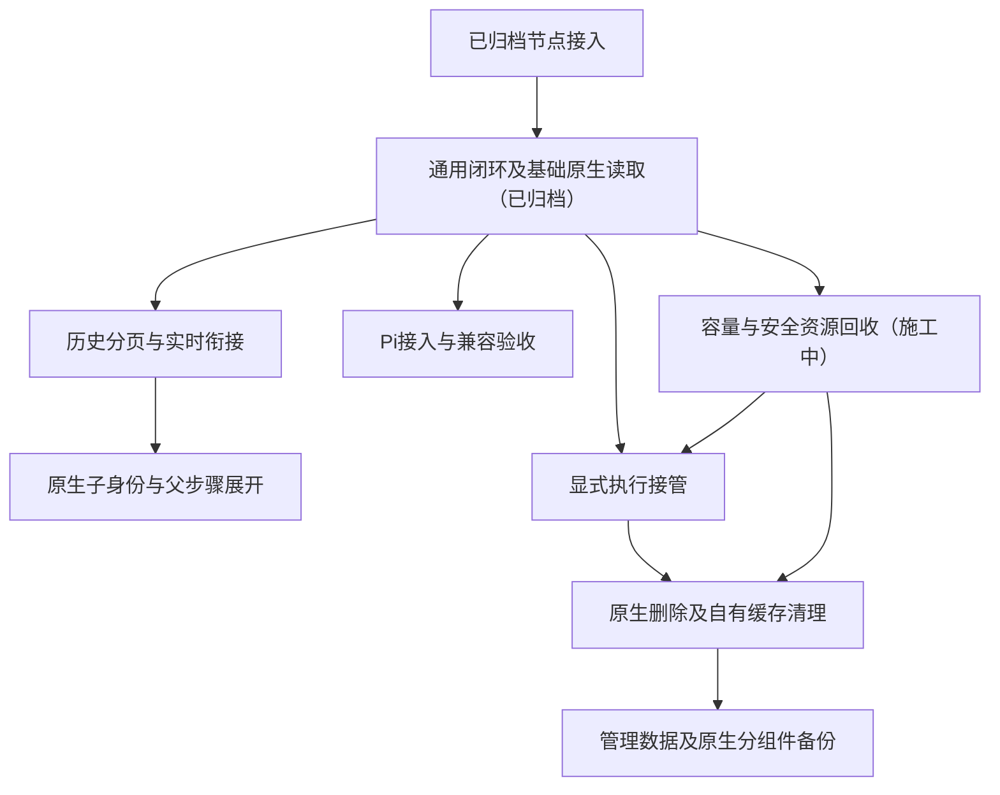

# 重建能力地图与 change 依赖

更新：2026-11-17。产品总体行为以 [总体设计](HARNESS_CONTROL_PLANE_REDESIGN.md) 与 `openspec/specs/` 长期规格为权威，本文维护各变更的能力归属、依赖关系与交付状态。

接入范围聚焦为 Codex（通用闭环首验已归档）与 Pi（独立接入规划已建立，尚未实施或真实验收）；DeepSeek Harness、ZCode 以及 OMP（Oh My Pi）均暂不适配，对应变更已移除。

`deliver-session-capacity` 的已批准第一阶段已实现全入口默认50名额、原所有者复用、未知主树拒绝、显式释放必要协调和Web容量事实；当前实际验收与最终工程状态以其 [执行计划](../openspec/changes/deliver-session-capacity/plan.md) 为准。自动回收、完整活动及安全关闭窗口证明、父子共享名额正向及真实长时间验收继续未完成。下方完整能力目标不表示这些分支已经交付。

## 已交付与当前规划

- [establish-node-access](../openspec/changes/archive/2026-10-30-establish-node-access/proposal.md) 已归档，节点与客户端信任规格及 33 例验收有效。
- [deliver-codex-session-loop](../openspec/changes/archive/2026-11-16-deliver-codex-session-loop/proposal.md) 已归档，通用会话闭环、共享队列、严格审批及 ACP 重放/当前连接视图规格已同步至 `openspec/specs/`。
- 当前活跃实施中的变更为 [deliver-session-capacity](../openspec/changes/deliver-session-capacity/proposal.md)。其余 6 个尚未开工的远期变更按轻量化规则仅维护需求与设计层（`proposal.md`、`specs/`、`design.md`），待正式开工时再基于当时真实代码树生成 `tests.md`、`plan.md` 与 `tasks.md`，不提前预生成或跨变更陪跑重审。

## 能力归属与阶段职责

| Change | 能力路径 | 核心职责 | 集成依据 |
|---|---|---|---|
| [deliver-codex-session-loop（已归档）](../openspec/changes/archive/2026-11-16-deliver-codex-session-loop/proposal.md) | harness-management、workspace-registration、session-execution、permission-approvals、structured-history、native-session-recovery、management-audit、acp-platform-constraints | 共享队列、额外限制核对、执行、严格审批及基础原生发现/读取；内容缓存与管理事务边界 | 已归档节点接入 |
| [deliver-session-capacity（施工中）](../openspec/changes/deliver-session-capacity/proposal.md) | session-resource-policy、harness-management | 50 主会话名额、30 分钟无活动回收请求、已知活动保护与管理账本协调 | 通用资源所有权和活动判断端口 |
| [integrate-pi-harness（待排期）](../openspec/changes/integrate-pi-harness/proposal.md) | pi-harness-compatibility | Pi（不绑定本机版本）与候选外部 ACP 服务端的配置及独立兼容性实证 | 通用闭环实际合同 |
| [deliver-history-navigation（待排期）](../openspec/changes/deliver-history-navigation/proposal.md) | history-navigation | 在标准重放视图上按轮次分页及衔接实时内容，支持缓存外重新定位 | 通用重放及可证明轮次 |
| [deliver-agent-session-tree（待排期）](../openspec/changes/deliver-agent-session-tree/proposal.md) | agent-session-tree | 读取原生身份、父子关系与子历史，在父步骤内展开并正序分页 | 历史导航及主树容量规则 |
| [deliver-native-session-import（待排期）](../openspec/changes/deliver-native-session-import/proposal.md) | native-session-import | 外部原生会话显式执行接管、唯一归属与重新校验，不导入历史正文 | 基础原生身份/加载端口及容量 |
| [deliver-session-data-lifecycle（待排期）](../openspec/changes/deliver-session-data-lifecycle/proposal.md) | session-data-lifecycle | 固定范围原生删除、最小审计及平台自有缓存/到期管理元数据安全清理 | 唯一执行归属、资源释放及原生删除证据 |
| [deliver-backup-recovery（待排期）](../openspec/changes/deliver-backup-recovery/proposal.md) | backup-recovery | 平台管理数据与原生数据分组件一致性备份及隔离新目标恢复校验 | 最终管理数据合同与原生一致性备份能力 |

基础会话列表、按标识读取和外部会话浏览由 `structured-history` 在通用闭环提供；分页属于 `history-navigation`，原生父子关系展示属于 `agent-session-tree`，执行接管属于 `native-session-import`，各自保留单一权威定义。

## 依赖关系

箭头描述通用能力的集成前置，不限制提前探测和独立设计。子树、容量与接管按各接入已满足的能力独立交付，各款缺失或未执行如实记录为 `not-run`。

## 横切边界

- **协议与重放准入**：运行时每次连接优先协商最高共同可用 ACP 版本并绑定当前能力；无标准重放的 Harness 可按实际能力接入并在当前连接模式下提示历史不完整，不开发厂商私有文件读取器。
- **身份与环境**：原生身份按“显式接入来源 + 原生会话 ID”协调（术语定义见 [领域术语表](../openspec/GLOSSARY.md)），默认继承节点环境并允许配置显式覆盖，不新增厂商白名单或环境指纹门禁。
- **查看与资源管理**：查看允许激活进程，但一旦引起实际加载即纳入主树资源所有权与 50 名额管理；实际标准重放刷新 30 分钟空闲计时但不形成任务保护，纯页面/缓存读取不刷新空闲计时。
- **平台管理数据**：身份、请求去重、执行归属、严格审批裁决与最小审计由节点 SQLite 可靠保存，不永久复制聊天或工具正文。
