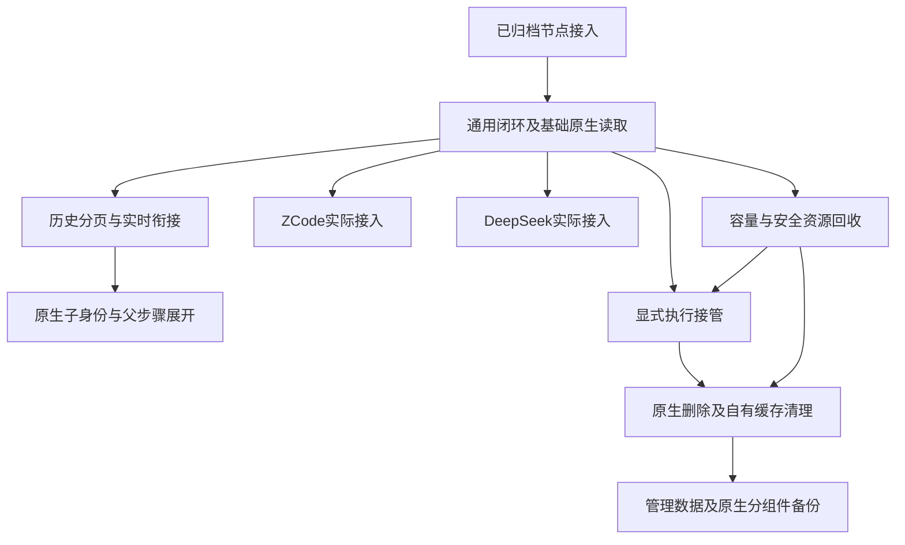

> Q-001（2026-10-31）以当前通用八份规格为准，旧重放门槛、固定输入期限及内容预算已取代。本文不声明本轮独立检视或产品验收通过。

# 重建能力地图与 change 依赖

更新：2026-10-31。产品行为以 [总体设计](HARNESS_CONTROL_PLANE_REDESIGN.md) 为权威，本文只维护能力归属、依赖与交付边界。会话数据权威已改为 Harness，所有会话实现暂停。

Q-001取代旧R2冲突规则：节点登记请求、受理授权接管、共享队列和节点时间取代每动作签名/固定输入期限/回退水位。必要管理状态失效停止相关动作，附加审计失败告警可继续，批准决定仍严格保存。

ARCH-001：用户确认本轮只修订设计与规格。原生工作及审批有效性、内容展示与资源引用安全由通用闭环负责；缓存外续读和目标重新定位由 history-navigation 负责；自动回收能力分层、完整活动及关闭窗口证据由 session-resource-policy 负责，harness-management 只呈现能力边界。父步骤展开复用通用内容安全及分页规则，不新增厂商读取器。其他会话能力不被自动回收受限取代，容量计数继续适用；本轮无代码、数据迁移或新版产品验收，旧 tests/plan/tasks 仍待独立重基准。

Q-001最新确认：重放不再是共同准入门槛，无重放Harness按实际能力接入并提供当前连接模式，明显提示历史不完整及缓存无法补回；不加厂商读取器或平台正文档案。DeepSeek原rc.5无重放调研不能据此整体阻断，其他能力仍须真实核验。

DC-001 补充归属：显式接入来源与默认环境继承由通用闭环负责，实际重放刷新计时及不形成任务保护由资源策略负责，接管复用同来源身份。来源配置不等于自动验证物理存储等价；不新增厂商身份探测、环境白名单或指纹门禁。原生范围在当前规格中沿用为接入来源命名空间，游标、子关系、删除授权和备份引用均按该来源区分；原生组件的一致性及删除授权范围校验仍分别遵循对应规格，不因来源配置而宣称已经证明。详细行为见总体设计及当前规格。

## 已交付与当前规划

[establish-node-access](../openspec/changes/archive/2026-10-30-establish-node-access/proposal.md) 已归档，节点与信任规格、33例原范围验收继续有效；不代表会话能力已交付。归档资料不改写。

9个活动 change 已有六类规划产物，本次调整 proposal、specs、design，并在 tests/plan/tasks 标明旧方案待重基准。文件齐备或 CLI planning complete 不代表可恢复编码。旧用例 ID、预期、任务勾选及审查记录保留原快照归属，受影响范围必须由独立 tester/reviewer 重新处理；本次没有新版独立验收或检视通过声明。

## 能力归属与调整

| Change | 能力路径 | 本轮职责 | 集成依据 |
|---|---|---|---|
| [deliver-codex-session-loop](../openspec/changes/deliver-codex-session-loop/proposal.md) | harness-management、workspace-registration、session-execution、permission-approvals、structured-history、native-session-recovery、management-audit、acp-platform-constraints | 建立共享队列、额外限制核对、执行、安全及基础原生发现/读取；重新定义内容缓存与管理事务 | 已归档节点接入 |
| [deliver-history-navigation](../openspec/changes/deliver-history-navigation/proposal.md) | history-navigation | 在标准重放视图上分页及衔接实时内容，不建立永久平台历史档案 | 通用重放及可证明轮次 |
| [integrate-zcode-harness](../openspec/changes/integrate-zcode-harness/proposal.md) | zcode-harness-compatibility | 接入配置与真实能力验收，历史能力独立报告 | 通用闭环 |
| [integrate-deepseek-harness](../openspec/changes/integrate-deepseek-harness/proposal.md) | deepseek-harness-compatibility | 接入配置与真实能力验收，不从恢复推断历史可读 | 通用闭环 |
| [deliver-agent-session-tree](../openspec/changes/deliver-agent-session-tree/proposal.md) | agent-session-tree | 读取原生身份、关系与子历史，在父步骤内展开 | 历史导航及具备关系/读取能力的接入，分别验收 |
| [deliver-session-capacity](../openspec/changes/deliver-session-capacity/proposal.md) | session-resource-policy | 保留30分钟/50主会话与活动保护；查看引起的实际加载计数 | 通用资源所有权和活动判断端口；未知目标保守保护 |
| [deliver-native-session-import](../openspec/changes/deliver-native-session-import/proposal.md) | native-session-import | 显式执行接管与重新校验，不再导入正文 | 基础原生身份/加载端口及容量；子树场景独立验收 |
| [deliver-session-data-lifecycle](../openspec/changes/deliver-session-data-lifecycle/proposal.md) | session-data-lifecycle | 只提供原生删除，清理平台自有缓存，无隐藏功能 | 唯一执行归属、资源释放及原生删除证据 |
| [deliver-backup-recovery](../openspec/changes/deliver-backup-recovery/proposal.md) | backup-recovery | 平台管理数据与原生数据分组件备份，缓存不算历史备份 | 最终管理数据合同、原生一致性备份能力 |

基础会话列表、按标识读取和外部会话浏览由 structured-history 在首个闭环提供，不推迟到 native-session-import。后者目录 ID 保留，职责是执行接管及失败协调，不是复制历史。分页属于 history-navigation，原生父子事实属于 agent-session-tree，不重复建立权威定义。

## 依赖关系

箭头描述通用能力的集成前置，不限制提前能力探测和独立设计。子树、容量与接管按各接入已满足的能力独立交付，不等待全部厂商；全部计划中接入的真实兼容性结果仍属于最终总体范围，各款缺失或未执行必须如实记录，不能因解耦依赖而签为全平台通过。各 Harness 的原生读取能力应在共用端口定稿前提前探测，不能等待下游实施后再发现共用合同不成立。通用闭环在正式容量 change 前仍需拥有明确的资源所有者、加载/释放端口与安全边界，不能留下无人管理的查看激活。

基础外部会话浏览不依赖完整执行接管、子树或容量策略交付；一旦浏览实际加载会话资源，就必须经当期资源加载接口管理，正式50/30分钟策略由 session-resource-policy 提供。完整子树浏览不作为容量或基础接管硬前置；可靠活动可由独立执行树接口提供，无法判断安全释放的目标保持保护，其他满足条件的目标不被阻塞。后续 plan 必须据新依赖重排工作包。

## 横切边界与恢复实施门禁

PV-001：通用闭环负责“优先最高共同可用协议”的版本选择与逐版语义；各 Harness 专项仅复用该优先级并验证真实可用组合，不按旧报告固定低版或另建版本映射。通用验收须覆盖高版优先、规范回退、对端选择原因缺失、新版能力保真及业务失败不降版重发；不因此宣称未来版、当前程序或新版产品已验收。

2026-10-30 本轮审查修订涉及异常重新准入、固定删除范围、子目标加载归属、子历史分页条件和按清单恢复，权威行为见各 change 当前规格。历史导航提供分页端口与条件，子树提供关系和步骤展示；子目标实际加载依赖当期资源所有权接口，正式名额规则由容量 change 提供。新增独立文档用例只覆盖本次修订，旧 tests/plan/tasks 的全面重基准及真实验收门禁继续保留，不恢复实现。

五项审查收口见各能力规格与 [领域术语表](../openspec/GLOSSARY.md)：原生身份跨启动入口稳定；加载/恢复审批关联真实操作而非伪造 Run；节点按 Harness 连接代际共享当前连接视图；平台处理、当前协议能力及安全条件决定准入，实测报告独立呈现；通用资源及查询机制按接入分别交付。

2026-10-30 职责补充：三个 Harness 相关 change 的专项部分面向能力调研、真实验证及接入配置。通用闭环另承担共用协议与业务实现，ZCode/DeepSeek 不另建厂商协议实现。受测版本仅限定证据；运行时每次连接协商并绑定协议版本及能力，不建立 Harness 到 ACP 版本的硬编码映射，也不把旧探测结果缓存为下次连接的协商结论。

- 标准 ACP 行为按实际协议版本及能力复用，v1/v2 目标和逐版验证原则保留。不因新数据权威自动授权私有桥接、私有文件解析或厂商专属生命周期。
- 标准重放、列表、平台分页及可选原生分页、身份、更新、附件、激活、删除和备份分别取证。无重放仍可按实际能力接入；不能把恢复或握手当重放支持，不建立永久平台历史或厂商读取器兜底。
- 平台身份、命令去重、执行归属、审批裁决/交付和审计仍需可靠记录；不将外部输入补造为平台操作，不永久复制聊天与工具正文作为审计。
- 查看允许激活进程且不限只读；查看本身不发送新输入或默认批准工具。实际加载适用互斥、容量与关闭顺序，单纯查询不占主会话名额。
- 新版详细合同、临时输入生命周期、管理数据迁移、独立用例及工作包须先完成并检视，再决定恢复实现。原 session-contract 已停用，不沿用其中历史表、入库版本、强刷或500ms/64KiB规则。
- 现有未提交代码与数据保留。本次没有执行数据库迁移、真实 Harness 探测或产品验收；文档结构检查不能代替这些证据。

## 仍待取证的技术输入

三款固定版本的历史接口及分页/身份能力、查看激活的实际影响、原生删除范围与确认机制、原生备份恢复机制仍待验证。用户已确认本轮三个产品分支，无需重复确认；出现必须改变已确认行为或增加桥接的具体证据时，报告影响与选项后再决策。
