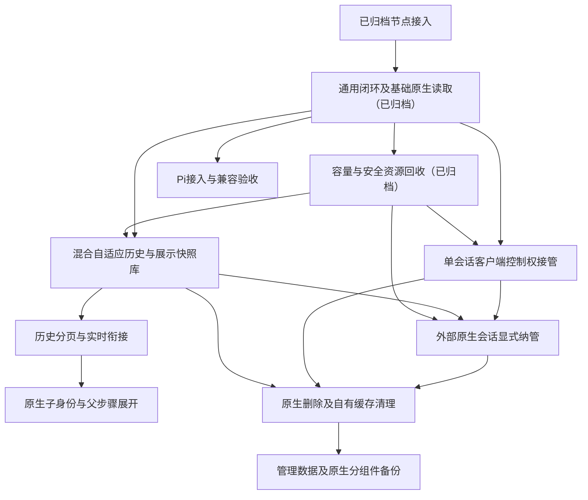

# 能力地图与变更依赖

产品总体行为以 [总体架构](overview.md) 与 [openspec/specs/](../../openspec/specs/) 长期规格为权威，本文维护各变更的能力归属、依赖关系与交付状态。

接入范围聚焦为 Codex（通用闭环首验已归档）与 Pi（独立接入规划已建立，尚未实施或真实验收）；DeepSeek Harness、ZCode 以及 OMP（Oh My Pi）均暂不适配，对应变更已移除。

`deliver-session-capacity` 已完成全部 20/20 任务并按 RB-001 双层 L6 闭环边界（真实 Codex 宿主与 68 分钟物理单调时钟层 + 50 会话控制面全量闭环与活动保护状态机层）于 2026-11-19 归档，相关长期规格已同步至 [session-resource-policy](../../openspec/specs/session-resource-policy/spec.md) 与 [harness-management](../../openspec/specs/harness-management/spec.md)，最终工程与验收结果见 [归档计划](../../openspec/changes/archive/2026-11-19-deliver-session-capacity/plan.md)。

## 已交付与当前规划

- [establish-node-access](../../openspec/changes/archive/2026-10-30-establish-node-access/proposal.md) 已归档，节点与客户端信任规格及 33 例验收有效。
- [deliver-codex-session-loop](../../openspec/changes/archive/2026-11-16-deliver-codex-session-loop/proposal.md) 已归档，通用会话闭环、共享队列、严格审批及 ACP 重放/当前连接视图规格已同步至 `openspec/specs/`。
- [deliver-session-capacity](../../openspec/changes/archive/2026-11-19-deliver-session-capacity/proposal.md) 已归档，50 主会话名额、30 分钟无活动自动回收请求、已知活动保护与管理账本协调规格已同步至 `openspec/specs/`。
- [deliver-session-control-takeover](../../openspec/changes/archive/2026-11-20-deliver-session-control-takeover/proposal.md) 已归档，单主会话客户端独占控制权接管（`controlEpoch`）、只读观察隔离与释放/重启自动归零规格已同步至 `openspec/specs/`。
- [deliver-session-transcript-cache](../../openspec/changes/archive/2026-11-20-deliver-session-transcript-cache/proposal.md) 已归档，节点物理隔离持久化展示快照库（30 天滑动保留 + 10 GiB 上限）、冷会话首屏秒开快照与后台单飞标准重放、及 `resume_only`/`pure_memory` 混合自适应恢复规格已同步至 `openspec/specs/`。
- 当前其余尚未开工的远期变更在 `.openspec.yaml` 中标记 `x-deferred: true`，按轻量化规则仅维护需求与设计层（`proposal.md`、`specs/`、`design.md`），待正式开工时再移除 `x-deferred: true` 并基于当时真实代码树生成 `tests.md`、`plan.md` 与 `tasks.md`，不提前预生成或跨变更陪跑重审。

## 能力归属与阶段职责

| Change | 能力路径 | 核心职责 | 集成依据 |
|---|---|---|---|
| [deliver-codex-session-loop（已归档）](../../openspec/changes/archive/2026-11-16-deliver-codex-session-loop/proposal.md) | harness-management、workspace-registration、session-execution、permission-approvals、structured-history、native-session-recovery、management-audit、acp-platform-constraints | 共享队列、额外限制核对、执行、严格审批及基础原生发现/读取；内容缓存与管理事务边界 | 已归档节点接入 |
| [deliver-session-capacity（已归档）](../../openspec/changes/archive/2026-11-19-deliver-session-capacity/proposal.md) | session-resource-policy、harness-management | 50 主会话名额、30 分钟无活动回收请求、已知活动保护与管理账本协调 | 通用资源所有权和活动判断端口 |
| [deliver-session-control-takeover（已归档）](../../openspec/changes/archive/2026-11-20-deliver-session-control-takeover/proposal.md) | session-control-takeover（并修订 session-execution、permission-approvals） | 按主会话根树的单客户端顶号式显式接管（`controlEpoch`）、其余受信设备会话内只读观察及随会话释放自动归零 | 已归档客户端信任、会话闭环与主树资源生命周期 |
| [deliver-session-transcript-cache（已归档）](../../openspec/changes/archive/2026-11-20-deliver-session-transcript-cache/proposal.md) | session-transcript-cache（并修订 structured-history、native-session-recovery、session-resource-policy） | 物理隔离的持久化结构化展示快照库（默认 30 天滑动保留 + 10 GiB 上限）、冷会话首屏秒开快照结合后台自动拉取补齐外部更新（满额优雅降级）及混合自适应恢复 | 通用闭环历史视图、原生恢复及 50 名额资源边界 |
| [integrate-pi-harness（待排期）](../../openspec/changes/integrate-pi-harness/proposal.md) | pi-harness-compatibility | Pi（不绑定本机版本）与候选外部 ACP 服务端的配置及独立兼容性实证 | 通用闭环实际合同 |
| [deliver-history-navigation（待排期）](../../openspec/changes/deliver-history-navigation/proposal.md) | history-navigation | 在标准重放视图与本地有效展示快照上按轮次分页及衔接实时内容，支持缓存外重新定位 | 通用重放、持久化展示快照库及可证明轮次 |
| [deliver-agent-session-tree（待排期）](../../openspec/changes/deliver-agent-session-tree/proposal.md) | agent-session-tree | 读取原生身份、父子关系与子历史，在父步骤内展开并正序分页，支持受管展示快照复用 | 历史导航、展示快照库及主树控制/容量规则 |
| [deliver-native-session-import（待排期）](../../openspec/changes/deliver-native-session-import/proposal.md) | native-session-import | 外部原生会话显式平台纳管、唯一执行归属与重新校验，不导入私有历史文件 | 基础原生身份/加载端口、容量及客户端控制权接管 |
| [deliver-session-data-lifecycle（待排期）](../../openspec/changes/deliver-session-data-lifecycle/proposal.md) | session-data-lifecycle | 固定范围原生删除、同步擦除目标展示快照、最小审计及平台自有缓存/到期管理元数据安全清理 | 唯一执行归属、会话控制权、资源释放及原生删除证据 |
| [deliver-backup-recovery（待排期）](../../openspec/changes/deliver-backup-recovery/proposal.md) | backup-recovery | 平台管理数据与原生数据分组件一致性备份及隔离新目标恢复校验（显式排除展示快照库） | 最终管理数据合同与原生一致性备份能力 |

基础会话列表、按标识读取和外部会话浏览由 `structured-history` 在通用闭环提供；跨回收/重启的受管展示快照与混合自适应恢复由 `session-transcript-cache` 提供；单会话多设备写控制互斥由 `session-control-takeover` 提供；分页属于 `history-navigation`，原生父子关系展示属于 `agent-session-tree`，外部原生会话平台纳管属于 `native-session-import`，各自保留单一权威定义。

## 依赖关系

箭头描述通用能力的集成前置，不限制提前探测和独立设计。控制权接管、展示快照库、子树与外部会话纳管按各接入已满足的能力独立交付，各款缺失或未执行如实记录为 `not-run`。

## 横切边界

- **协议与重放准入**：运行时每次连接优先协商最高共同可用 ACP 版本并绑定当前能力；无标准重放的 Harness 可按实际能力接入，结合展示快照库保留平台已观测历史并如实标记外部变更/不可恢复边界，不开发厂商私有文件读取器。
- **三层权限与控制分离**：节点级设备信任（`client-trust`）、平台对外部原生会话的执行纳管（`native-session-import`）与客户端级单主会话控制权接管（`session-control-takeover`）严格正交。同一时刻单主会话至多 1 台受信设备持有写控制权，其余受信设备保持只读观察；控制权仅驻留活跃运行期，随会话释放或重启自动归零。
- **身份与环境**：原生身份按“显式接入来源 + 原生会话 ID”协调（术语定义见 [领域术语表](../../openspec/GLOSSARY.md)），默认继承节点环境并允许配置显式覆盖，不新增厂商白名单或环境指纹门禁。
- **首屏快照秒开、后台自动同步与资源管理**：打开未加载会话命中有效展示快照库时首屏立即零等待返回（满额降级或无重放兜底时不消耗 50 主会话名额、不刷新 30 分钟空闲计时）；若对端支持标准重放，节点同时在后台按容量规则自动拉取一次最新原生历史补齐外部新增内容（重放后无运行任务时仍属可安全淘汰空闲候选，且无实质内容变更时不虚刷快照 30 天保留期）。
- **双轨存储隔离**：客户端身份、请求去重、执行归属、严格审批裁决与最小审计由核心控制面 SQLite 可靠保存；UI 结构化展示快照由物理隔离的展示快照库（默认 30 天滑动有效期 + 10 GiB 总容量上限）独立维护，快照 I/O 异常绝不阻塞核心安全裁决，且绝不拼回文本充当模型上下文。
